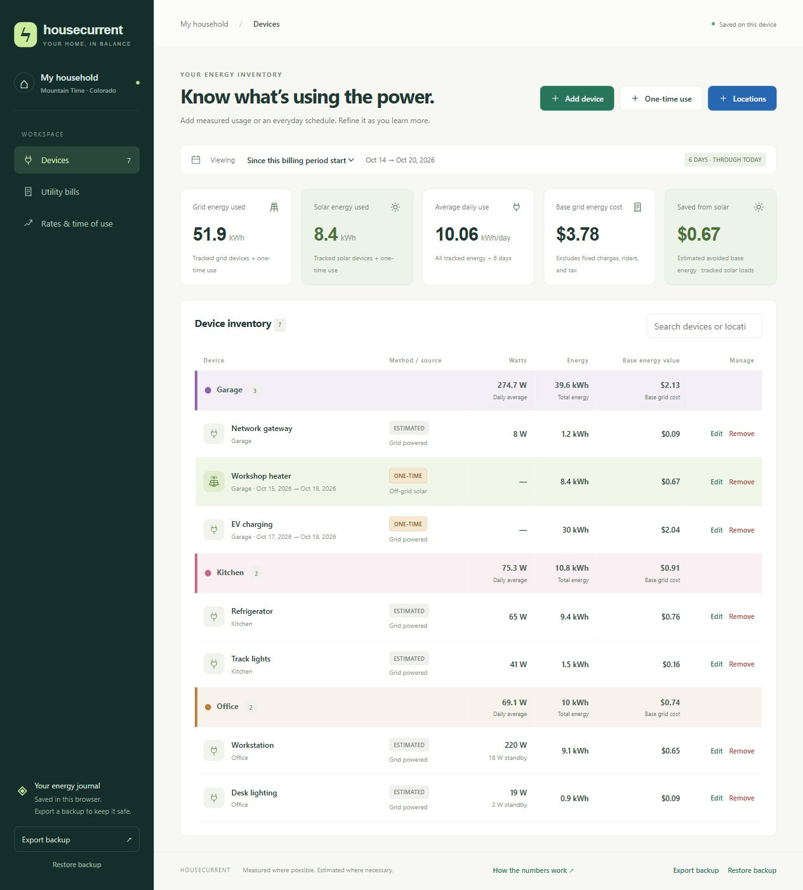

# Housecurrent

A household electricity tracker for understanding what uses power, what it costs, and how much off-grid solar helps. Track devices in watts or measured kWh, apply seasonal time-of-use rates, and compare usage across utility billing periods.

The editor runs entirely in your browser. There are no dependencies to install, accounts to create, or network assets to load.



*Devices page with example data. The example device inventory is for the screenshot; new installations start with an empty inventory.*

## Get started

1. Download this repository and open **Housecurrent.html** in a modern browser.
2. On **Devices**, create locations and add appliances, computers, lighting, or other loads.
3. Set your electricity prices and shared nighttime hours under **Rates & time of use**.
4. Add electricity meter-read intervals under **Utility bills** to define your reporting periods.
5. Export a JSON backup regularly.

The app includes an anonymized starter electricity bill and a sample seasonal rate schedule. Update those settings to match your household.

## What it tracks

- **Devices:** Enter active watts, standby watts, and a schedule, or record multiple measured kWh intervals. Standby runs outside active hours and is not counted twice.
- **Schedules:** Run every day or on selected days, continuously or for specific hours. The Nighttime hours checkbox follows one shared winter/summer schedule configured on the rates page.
- **One-time use:** Record EV charging or other occasional loads as total kWh, or use continuous watts between two dates. Delivered-energy entries can account for charging losses; measured wall energy is used directly.
- **Locations:** Add, rename, remove, and color locations using the blue Locations button. Inventory groups appear by base grid cost, highest first (using the midpoint for cost ranges); headers show average watts, total energy, and base grid cost.
- **Power sources:** Separate grid-powered, off-grid solar, and mixed/unallocated loads. Solar items have a panel icon and green background.
- **Billing periods:** View a saved utility billing interval or usage since the current billing period began. Entries outside the selected period are hidden.
- **Summary:** See grid kWh, solar kWh, average kWh/day, base grid energy cost, and estimated savings from solar.
- **Backups:** Export and restore validated JSON files containing records, locations, rates, and settings.

## Rates and calculation boundaries

The supplied schedule uses summer rates from June through September and winter rates from October through May. Peak pricing is Monday–Friday, 5–9 pm, using household Mountain Time. Rates are editable.

- Reporting intervals include the starting date and exclude the ending date.
- Modeled costs and savings cover **base energy charges**, not the full utility bill.
- Utility bills already measure grid imports; solar is never subtracted from those imports again.
- An AC solar meter after the inverter measures delivered energy. Cumulative solar readings retained in backups use counter differences and support meter-reset baselines. The current interface tracks solar loads on Devices rather than providing a separate solar journal page.
- Solar kWh entries without hourly timing use estimated savings of **$0.08/kWh in winter** and **$0.10/kWh in summer**. A single unknown allocation spanning both seasons retains a range. Scheduled loads follow their modeled times; cumulative solar meter values retain a time-of-use range.
- Partial measured intervals and total-kWh one-time entries are excluded rather than prorated. Continuous-draw estimates can be split across billing periods.
- Holiday exceptions and rate effective-date histories are not implemented. DST transition days use a 24-hour wall-clock schedule approximation.

## Local data

The editable app saves to browser-local storage. Data is separate between browsers and between `file:`, `localhost`, and `127.0.0.1` origins. Export a backup **before changing browsers, moving between origins, or clearing browser data**.

Source files do not contain the household device inventory. Personal backups, generated website snapshots, and local hosting metadata are excluded from Git.

## Read-only website export

You can publish a self-contained snapshot on a static host such as DreamHost. Visitors simply open the link: the data is already included, and there are no add, edit, remove, restore, or rate-editing controls. No backend or visitor file upload is needed.

Export a backup from the local editor, then run this command from the project folder:

```sh
node build-website.mjs "path/to/backup.json" "website/index.html"
```

Upload the generated `website/index.html` to a separate folder on your website, such as `housecurrent/index.html`. Upload only that viewer file; keep JSON backups and the editable app local. For updates, export a fresh backup, rebuild, and replace the hosted file. This is a manually updated snapshot, not automatic cloud synchronization.

Anyone who can access the hosted file can read the records included in it. Add access protection through your host if needed. GitHub publication of this source repository does not deploy a website.

## Development

Node.js is needed only for these developer commands. No package installation is required.

```sh
npm test        # Energy calculations, validation, and export tests
npm run check   # JavaScript syntax checks
npm run build   # Regenerate both self-contained HTML copies
npm run dev     # Local preview at http://127.0.0.1:3022/
```

Editable source files:

| File | Purpose |
| --- | --- |
| `dist/index.html` | Application shell |
| `dist/styles.css` | Layout and appearance |
| `dist/app.js` | Views, forms, and browser persistence |
| `dist/energy.js` | Calculations, validation, and data migration |
| `build-standalone.mjs` | Builds the offline HTML app |
| `build-website.mjs` | Builds a read-only viewer from a backup |
| `tests/` | Regression tests |

After editing the source, run the checks and rebuild `Housecurrent.html` before distributing it.

## License

MIT. See [LICENSE](LICENSE).
